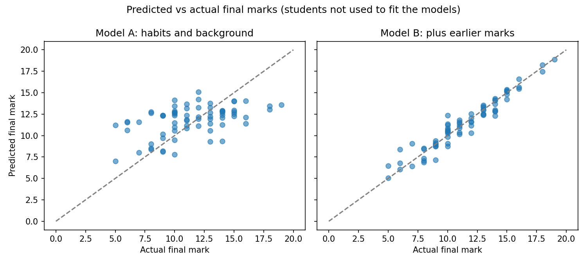

# What Explains Students' Final Marks? (Linear Regression)

A regression analysis of 395 secondary school students' maths marks. The question: how much do habits and background explain the final mark, and how much do the earlier marks add?

## Key findings

- **Habits and background explain only about a quarter of the differences in final marks** (R-squared 0.26, adjusted 0.22). Four factors are clearly linked to the final mark: past failures (each one goes with a final mark about 0.8 lower), going out with friends (about 0.4 lower per step on the 1-5 scale), absences (about 0.07 lower per absence) and receiving extra school support (about 2.4 lower).
- **Extra school support goes with lower marks, probably because it goes to students who are already struggling.** The data cannot show that support lowers marks.
- **Adding the two earlier marks (G1 and G2) lifts R-squared to 0.94.** The second-period mark does almost all the work: one extra mark in G2 goes with about 0.87 more in the final mark.
- **Tested on 72 students the models had not seen, the typical error was 3.11 marks if we always guess the average, 2.74 with habits and background (Model A), and 0.83 with the earlier marks added (Model B).** Habits and background alone are only a little better than guessing the average.

## Data
UCI Student Performance data, maths class (student-mat.csv): 395 students, 33 columns. Final mark G3 is out of 20. Source: https://archive.ics.uci.edu/ml/datasets/student+performance (I used the copy on Kaggle).

## How I cleaned and checked the data
- There were no empty cells and no duplicate rows.
- 38 students have a final mark of 0. All 38 also have 0 absences, and 13 of them already had a second-period mark of 0. This looks like students who left or never sat the final, so I left them out of the models. That leaves 357 students.
- Leaving them out matters: with them in, absences showed almost no link to the final mark, because their fake "0 absences" hid the real pattern.

## Method
1. **Model A:** linear regression of the final mark on 18 habit and background factors (study time, past failures, absences, age, parents' education, travel time, going out, free time, family relationships, health, weekday and weekend alcohol use, and five yes/no questions such as extra school support, family support and internet at home). No earlier marks.
2. **Model B:** the same factors plus the first-period and second-period marks.
3. **Checks:** the model residuals pass normality tests (Omnibus p = 0.59, Jarque-Bera p = 0.56) and Durbin-Watson is 2.10.
4. **Test:** I held back a random 20% of students (72), fitted both models on the other 80%, and measured the typical error on the held-back students.

## Limitations
- These are links, not causes. For example, extra support probably follows low marks, and not the other way round.
- About 20 factors were tested, so a few small links could be chance. I only rely on the strongest ones.
- Model B is not an early warning tool, because the second-period mark only exists late in the year.
- The models cannot spot students about to drop out, because I removed the 38 students with a final mark of 0.
- The test results come from one random split of 72 students, so another split would give slightly different numbers.

## Tools
Python (pandas, statsmodels, scikit-learn, matplotlib) in Google Colab.

## Files
- **student_regression.ipynb**: the full notebook with code and explanations
- **q_regression_predictions.png**: predicted vs actual final marks for the 72 held-back students
